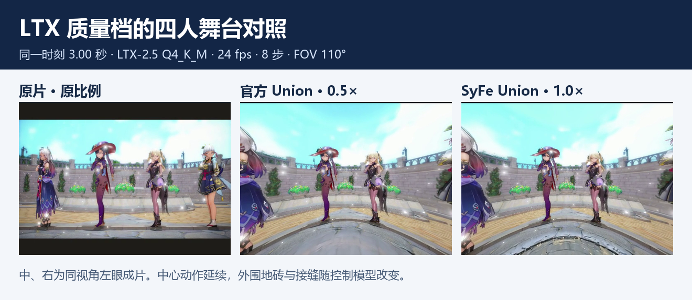

# mmd2vr

把普通 2D MMD 视频转成立体 VR180 或影院 Full SBS。网页负责选片、批量排队和查看进度，转制服务在本机运行。输出为左眼在左的 HEVC MP4。



[当前成片对照](docs/benchmarks.md) · [历史实验图与取舍](docs/experiment-history.md)

## 功能

- 用 iw3 和视频深度估计合成双眼画面。VR180 支持 75°、100°、110° 基准视角，横向曲率与原片视角倍率可调。
- 可选 LTX‑2.3、LTX‑2.5 或 MiniMax H3 扩画。外围生成后贴回双眼原片，并在外围做接缝融合。
- LTX 快速档用官方 Union（0.5× 参考分辨率），质量档用 SyFe Union（1.0×）。两档均为 24 fps、8 步、110°、横向曲率 100%、前半球、倍率 1.00×。H3 两档分别用普通 NVFP4 和 NVFP4 HQ，质量档启用单遍 H3 Union。
- 批量提交会检查已有成片，符合源文件、格式、时长和视场的结果会跳过。单片可主动重新提交。候选成片经解码校验后发布。

## Windows

需要 NVIDIA GPU、可用的 NVENC、FFmpeg/FFprobe、uv 和 PowerShell。先准备一个有权使用的普通 SDR 视频。

```powershell
./setup.ps1
./start.ps1
```

打开 [本机 WebUI](http://127.0.0.1:7860/)。默认从项目下的 `input` 读取，成片写到 `output`。可在启动前通过 `MMD_INPUT` 和 `MMD_OUTPUT` 指定绝对路径，包括已挂载的共享目录。要先验证立体转制，可以在界面关闭「启用外围扩画」，用几秒短片试跑。

启用外围扩画前，按[模型配置](docs/models.md)安装 ComfyUI，并准备所选模型的文件。播放器按左右眼顺序和球面标记识别 VR180。原片帧率最高保留到 60 fps，扩画采样帧率可独立调整。

## Docker Compose

在已配置 NVIDIA 容器运行时的主机上，复制 `.env.example` 为 `.env`。建立输入、输出、状态和模型目录，再按实际路径与文件权限设置宿主机挂载及 UID/GID。输入目录以只读方式挂载。网页使用的容器路径为 `/input` 与 `/output`。

```sh
cp .env.example .env
mkdir -p input output state models
docker compose build
docker compose run --rm worker nvidia-smi
docker compose up -d
docker compose ps
```

示例端口只绑定回环地址。需要从其他设备访问时，在 `.env` 中设置自己的 `MMD_BIND_IP`，并控制访问范围。WebUI 与转制服务共享 `state` 和 `models`。较长视频的临时文件可能显著大于原片。

## 实测与依赖

- [当前版本测试与耗时](docs/benchmarks.md)
- [历史实验档案 · 采用、放弃与未完成的方案](docs/experiment-history.md)
- [模型目录和获取来源](docs/models.md) · [导入自己的扩画模型](docs/models.md#导入自己的外围扩画模型)
- [第三方来源及许可证](THIRD_PARTY_NOTICES.md)
