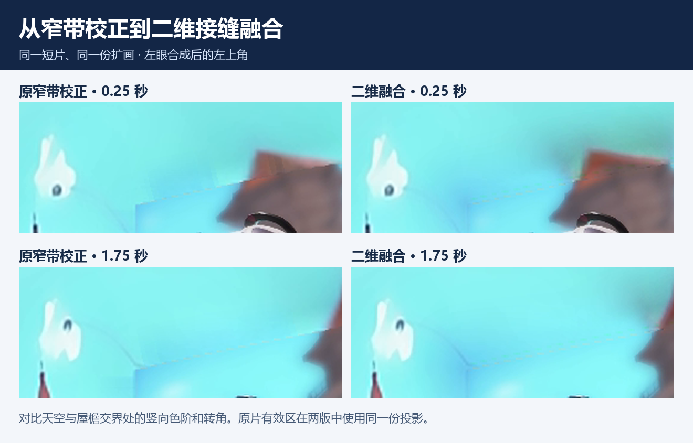
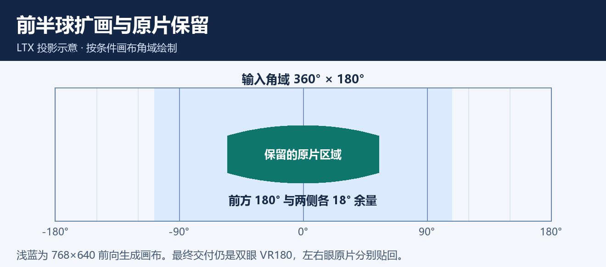
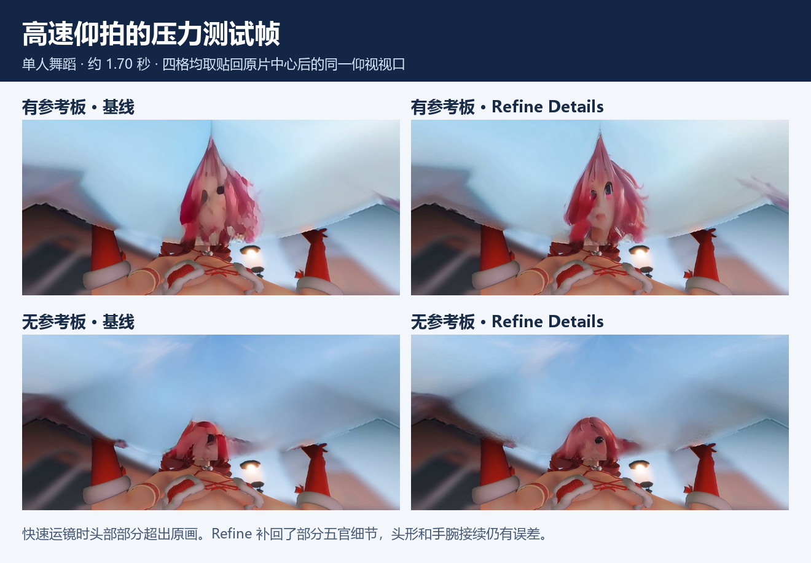
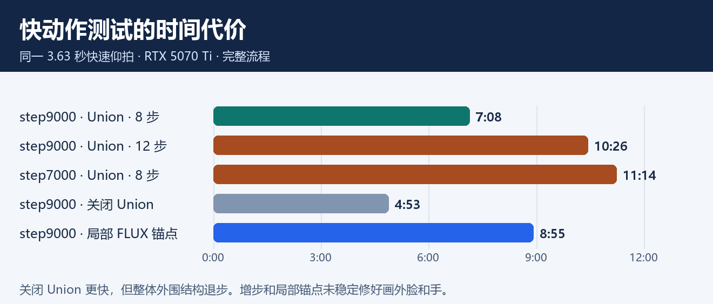
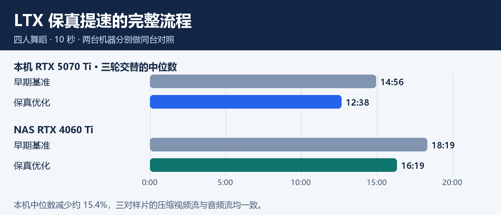

# LTX 扩画、画质和提速实验

返回[历史实验档案](experiment-history.md)。LTX 路线把 2.3 或 2.5 底模、360° 扩画适配权重和可选的 Union 控制合在一次扩画采样里。最终交付是 VR180 双眼，扩画画布角域与输出视角分别设置。早期技术对照与当前版本的参数传承见[现行测试记录](benchmarks.md)。

## 模型、控制和提示词

| 实验 | 方法与结果 | 处理决定 |
| --- | --- | --- |
| LTX 2.3 平面、黑底及全景 | 平面扩画后投影、直接全景输入及不同参考底色均做过成片。不同路线的遮罩和合成顺序都会影响原画边缘。全景路线中曾把人物周围的暗影误当成轮廓，在球面上拉成残影。 | 采用投影后的统一角域作扩画参考，已知原片双眼在最终合成中覆盖。 |
| 360VR 扩画权重与 step9000 | 早期版本的全景扩画自然度逐步改善。step9000 做过五种约 10 秒素材的验证，覆盖多人舞蹈和近景。扩画仍可能在人像边缘生成额外面孔或拉伸肢体。 | step9000 成为 LTX 基线。 |
| step7000 + Union | 同一 3.63 秒快速仰拍，8 步、同段 Union，参考版 step9000 完整 427.8 秒，step7000 为 673.6 秒。 | 保留 step9000，旧权重未带来足够的运动画质收益。 |
| step9000 8→12 步 | 同一仰拍对照 427.8→625.9 秒。重点看 1.70 秒脸、手腕和连续动作。 | 增步未稳定修好侧边人物，8 步保留。 |
| Union 关闭与开启 | 同一 3.63 秒快动作，关闭 292.9 秒、开启 427.8 秒。关闭后速度更快，开启时整体外围结构更好，脸和手仍有误差。 | 保留 Union。 |
| Union 权重与深度注意力 | 试过 0.15、0.35、0.50、0.65、1.0，以及深度条件注意力衰减到 0.6。较强控制减少多个镜头的画外独立人物，有时偏写实。减低权重后，对结构和多余人物的约束也减弱。 | 优先保留强结构约束，再修外围材质。较低权重和注意力留作可调项。 |
| LTX 2.3 动漫 LoRA | 近景 110° 同段比较关闭、0.35 和 1.0，四人版也做过 Union + 动漫 LoRA。能改变材质，未可靠减少额外人物和错位。 | 未作为发布默认。 |
| V2V For Anime、自动选无人参考 | 从当前镜头自动选背景片，再做视频风格调整。留有原参考和自动选择的版本。背景风格变化，透视、接缝和人形约束仍受第一遍生成支配。 | 未接入默认。 |
| ReStyle 第二次推理 | 用同一 Union 成片和原片风格参考，比较原流程及仅画外、强度 0.3。仅从提交到写出分别约 143 秒和 148 秒。 | 进一步增加推理时间，未设为默认。 |
| 通用提示、少生人物与区域负向 | 比较减少独立人物、只补原可见角色、避免写实人物、限定画外负向和带 no humans 的短提示。小样本里效果时好时坏，约束过强还可能画掉原有出框的人。 | 保留通用提示。批量仍依靠条件和掩码。 |
| 画外人物局部重绘 | 自动找疑似新增人物并重绘，选区流程有成片，重绘及启动约 160 秒。修复存在重影、画面不连贯和误选区。 | 停用。 |
| LaMa 关键帧传播与纯纹理复制 | 复用同一 2 秒选区，公共准备约 9.2 秒。LaMa 生成与传播约 3.8 秒，纹理复制约 16.7 秒。两种都容易留下补丁质感和重复纹理。 | 速度可行但效果未过关。 |
| 原片有效区参考掩码 | 16 fps、8 步固定种子，首镜头单窗口原版约 155.2 秒，加权约 156.0 秒。后续 24 fps 室内同段中，关闭时上沿会出现室外景象，原片 1.0、外围 0.10 时保留暗室、灯具与窗框。按时间稳定度选背景的版本另生成了白鞋。保护区编码前比较差值为零。 | 采用有效区加权，并保留参数。单一主色和稳定区域加权未设为默认。 |
| 外围参考权重 0 与 0.10 | 复用有宽黑框的同一窗口比较两档。改变外围参考可影响黑框，也会改变天空和原画侧边的延续。 | 保持参考掩码开启，宽黑框另用接缝与生成约束处理。 |
| LTX 2.5 Distilled Q4_K_M | 实装 16 GB 卡可用的量化底模，沿用 step9000 与 LTX Union。快速仰拍的部分区域优于旧底模，动态脸和手仍可错位。五段 10 秒正式组合另有[整体计时](benchmarks.md#五段完整工作流)。 | 和 2.3 一起保留。 |
| 官方与 SyFe Union | 使用各自参考分辨率 0.5× 和 1.0×，按同窗口、种子、VR180 视口比较。局部地砖、灯柱更稳，手腕、脸和极端运动仍有问题。 | 2.3 与 2.5 的质量快捷键采用 SyFe，快速快捷键保留官方 Union。 |

### 早期 step9000 的五段成片

这组是 step9000 上线前后的首轮五类型成片记录。下表独立于后续前半球、LTX 2.5 和 SyFe 的五段对照。

| 约 10 秒源片 | 完整耗时 | 扩画窗口 |
| --- | ---: | ---: |
| 双人舞蹈 | 816.2 秒 | 3 |
| 三人舞蹈 | 810.8 秒 | 3 |
| 四人舞蹈 | 847.9 秒 | 4 |
| 五人舞蹈与拉远 | 1212.1 秒 | 16 |
| 室内近景 | 636.6 秒 | 2 |

## 接缝、原片与几何

| 实验 | 方法与结果 | 处理决定 |
| --- | --- | --- |
| 平面扩画与全景后处理 | 在平面和 VR 投影下分别检查原片边界。近原片的暗彩带可能由生成带入，源图有效区、外围生成区和实际视口需用同一套映射作对照。 | 将保护区掩码、输出视口和成片几何纳入验收。 |
| 外围保边简化、原片配色 | 三版并排，原 Union、仅外围简化纹理、简化加同镜头背景取色。中间版保留结构，降低偏写实纹理。部分场景启用原片配色会过度带入近景色块。 | 采用外围保边简化，原片配色可选。 |
| 动漫细节与窄带亮度 | 复用同一四人短片，对比开启动漫细节与增加外围窄带校正。亮度过渡改善，竖边与角落在只用窄带时仍有框感。 | 亮度和细节分别设控件，进一步用二维过渡。 |
| 外围二维平滑过渡 | 仅改变框外亮度梯度与位置权重。122 帧后处理试验约 18.9 秒，抽查各竖边和四角，同时检查天空变化及连续帧。 | 用二维过渡支持接缝修正，原片中心保护不参与融合。 |
| 64 / 128 像素与自适应宽度 | 同一 3.42 秒四人镜头、复用扩画，只重做合成。比较 64、固定 128 及按背景平滑度调宽。较平滑的天空、地面允许更长的过渡，纹理边界保留更窄的混合区。 | 采用自适应接缝。 |
| 生成前延续背景 | 四人及室内近景均做过同种子短镜头，比较外围被铺入同镜头背景、保护原片和宽黑框变化。不同底色和人物出框时表现不一。 | 未用预填充替代现有接缝默认。 |
| 100° / 110° 与画面锁定 | 用最终成片的上仰和平视视口和同帧原片比对。110° 扩大原片角域。对于原本已有的光照、反射或水流，按同帧源片归因。 | LTX 默认 110°，评估仍必须看对齐的原片。 |
| 前半球 + 侧边余量 | 同一 3.63 秒片，较大画布完整 307.7 秒，对照 448×384 为 286.1 秒。局部画外节省推理，最终仍为 VR180。实际窗口和密度随模式改变。 | 前半球启用。原片保真在最终双眼合成验证。 |
| 倍率 1.10×、原片保真与视口复查 | 比较 1.10×、复用扩画只重做双眼中心，以及平视广视口。1.10× 在窄的上仰视口里少见下半身和两侧，复用同成片换较宽平视视口能核查实际覆盖。 | 默认倍率恢复 1.00×，保留滑块。 |
| 横向曲率 50% / 100% | 同段核对曲率调大后上/下沿、两侧的原片覆盖。边界形状从较弯曲转向更接近矩形，中心可视角与侧向覆盖应分别核查。它改变映射与可见覆盖，运行时间还受固定画布和切镜数主导。 | 保留 100% 默认和曲率设置。 |

## 动作、脸和手

主要观察单人快速仰拍约 1.70 秒的脸、双手与邻帧衔接。仅对准确部位有实际证据时，才将生成局部与原画边缘比较。实验中联合验证了多人场景，避免只靠固定人数或特定角色描述。

| 实验 | 方法与结果 | 处理决定 |
| --- | --- | --- |
| 自动 Ingredients 参考板 1.0 / 0.5 | 本地自动选择原片中的参考帧，与同段无参考版比较。少数脸部细节更清楚，但动作和大腿接缝偏移，降低到 0.5 也未稳定消除。历史两档的整片记录分别约 1406 和 965 秒。 | 未设为默认。 |
| Refine Details 整个画外 | 比较参考板版附加整区细化、仅细化、仅脸使用参考板再细化。局部五官更清楚，尖头、腕部错位和形变仍在。第二阶段的三个窗口本身即可花数分钟到十几分钟。 | 未采用二次细化。 |
| 单遍 Refine 0.25 / 0.5 | 有单遍记录，主要核对在同一次采样内加权对脸手和结构的影响。局部质地变化，未在连续帧上取得稳定位置改善。 | 停止扩大试验。单次运行的绝对耗时不用于强度间性能结论。 |
| 单生成关键帧、30 fps、自动挑参考 | 测在 1.70 秒附近插一个关键帧，及提高生成帧率至 30 或自动寻找运动参考。不同方法都对照过动态脸手，错误主要仍在画外高速运动。 | 不添关键帧或更高帧率作默认。 |
| 仅外围做光流，24 输入保留 60 输出 | 测按低帧率采样、通过光流补外围，以及 24 fps 输入、60 fps 原片中心交付。用于分开判断生成错误和插帧拖影。光流能过渡相近帧，快速进出框仍会留下拖影或重复轮廓。 | 保留原片帧率输出，未采用这些动作专用补救。 |
| DWPose 等原片关键点与遮边真值 | 用脸和手的原片关键点、肩肘腕、同角色邻帧及真实邻帧传播。对单人和四人做遮边留出，分别统计覆盖、错位与可信位。快速越界会缺少真值支持，角色越多越难稳定匹配。 | 保留验证方式，未把普遍外推的姿态设为必选。 |
| HaWoR 手部重建 | 对短窗有实际手部重建和可用帧记录。对同一只手，测试腕部误差随帧变化，示例从不足 1 像素到超过 20 像素。 | 局部检测结果不足以成为所有画外帧的可靠约束。 |
| 已知脸位与分区脸/四肢 | 临时遮住回框后可见的脸，将同角色另一帧的参考对齐到已知位置，另测试范围更宽的骨架和外部参考板。未绑定位置的参考把脸纹理扩散到背景，分区引导仍出现贴边错位。 | 参考板和四肢引导已退出默认控件。 |
| 单遍局部采样 | 对比密集区域、稀疏区域、姿态三种方案，与不加分区的同段 274.7 秒对照。三种完整耗时约 317.0、311.0、298.8 秒。 | 画外脸和肢体未稳定通过，多区控制不保留。 |
| FLUX 单图扩画与局部对齐 | 同一仰拍帧，比较投影灰底、先平面扩图后投影、用 LTX 外围作结构底、屏蔽 LTX 人形再重绘。灰底版静态观感较好，LTX 结构输入有额外的手。颈部和腕部的自动局部对齐未稳定改善。 | 静帧有价值，未形成连续批量路线。 |
| 纯 FLUX 三个关键帧与跨帧参考 | 在约半秒内画首中尾三张，用双向光流回填，另做后帧参考前帧。部分帧更清楚，首尾仍可能保留已经回到框内的人脸，造成额外脸与重影。 | 单靠图像模型的整段扩画停止。 |
| Union + 局部 FLUX 锚点 | 只把可靠的局部画外关键帧接进视频生成，同段完整约 535 秒，相比基线 428 秒。 | 没有以足够稳的脸手改善抵消延时。 |
| 快动作其他视频模型 | 同段测 Argus、MimicMotion 1.1、Wan2.2-Animate Q4_K_M 与 LTX 2.5 + CQ Motion Transfer。Argus 单窗口采样约 42.5 秒，输出 25 帧。其余三组模型阶段记录约 49.3、145.6、73.1 秒。姿态准备、保护区校验和头显编码分别核算。 | 保留试验结果，未替代完整 LTX 工作流。 |
| RealisDance-SD | 同段产出复合头显片，37 帧、10 fps、448×320、24 步，推理约 56.8 秒。姿态、SMPL 和手部准备另计，合成输出保留 60 fps 原片。 | 快速仰拍时的脸与双手接续未达到通用要求。 |

这一帧专门检查快速仰拍时出框的头和双手。Refine 补回了一部分眼部细节，头形及手腕接续仍有误差。

## 完整流程提速与取舍

| 实验 | 方法与结果 | 处理决定 |
| --- | --- | --- |
| 分阶段保真提速 | 四人 10 秒同机交替三次，完整耗时中位数 895.8→758.2 秒，减少约 15.4%，三对视频与音频压缩流一致。五种本机 10 秒样片也逐一核对。NAS 的四人 10 秒为 1099.0→979.2 秒、约 33 秒近景整片 2982.9→2685.5 秒。NAS 与旧版重复比较区分了生成波动和中心保护。 | 采用保真准备、双眼和输出优化。 |
| 24、16、12 fps 与 8、6 步 | 四人完整片从 2 流旧基准约 884 秒降到 16 fps 试验约 693 秒。近景在 16 fps 的 8 步及 6 步版本均出现室外；这个矩阵无法将变化只归给步数。6 步加重某些画外人形，12 fps/6 步有出框白鞋缺失。 | 保留 24 fps、8 步为默认，避免把快速档等同于所有模型降帧、降步。 |
| 2 与 4 条权重传输流、仅生成视频 | 四人 10 秒完整约 884.1 与 871.9 秒，而隔离的四扩画窗口回放为 393.2 与 395.2 秒。仅推算画面一版完整约 811 秒，外围有所变化。成片音轨仍来自原片。 | 权重传输保留 2 流基准，常规推理保留联合设置。 |
| GPU 人物检测与重复帧缓存 | 保持三种检测方向、复用重复帧框。NAS 引导准备回放约 92.2→33.2 秒。人物检测用于参考掩码和深度条件中的保护，模型仍负责生成。 | 两档优先 GPU，保留切换。 |
| 双眼共享解码、并行投影和编码 | NAS 局部双眼阶段从约 19.0–19.8 秒降到 14.5–14.7 秒，解码散列一致。另试定点坐标表，发现投影像素改变。流水线保留浮点、原分辨率和重采样。 | 采用共享解码、并行和流水线，未用定点表。 |
| 估深批大小 1、2、4 | 一次回放 48.9、43.6、43.3 秒，批大小 2 和 4 产生不同的立体中间片。 | 采用原 VDA Metric-L、批大小 1。 |
| 稀疏补边与外围动漫细节帧率 | 只投影有邻帧信息的像素，120 帧预热基线 25.11 秒，两次变体 25.15 和 25.38 秒。细节层从 10→8 fps 又只省约 1 秒，输出有变化。 | 保留既有观测区域计算和 10 fps 细节默认。 |
| PNG 压缩等级 | 49 帧读写约 2.8→1.2 秒，像素一致，临时文件约 63→120 MB。 | 使用低开销中间 PNG 的方案，记录磁盘代价。 |
| 流式 Union 深度 | 完整成片约 774 秒，和同机优化基准接近。 | 无稳定提速，停止追测。 |
| CUDA 投影和接缝 | CUDA 内核有成片，整段 893 秒，比同机优化基准慢约 18%。另有全 GPU 驻留路线的准备。 | 前者停止。全驻留后续实验未继续。 |
| LTX 模型格式与量化内核 | 做过真实层权重的微基准及逐张量 FP8 的完整对照。同段 NAS 完整约 983→945 秒，本机约 831→876 秒，结果随硬件和运行时变化。另有 Ada FP8 与 NVFP4 初筛未通过完整成片门槛。 | 小算子成绩未用来推算整片。额外两条路线停止。 |
| 自动切镜、最短窗口与跳过成片 | 真实切镜需要切断扩画上下文。快速拉远样片会被拆到 16 个窗口，9 个单帧仍要进入最小 9 帧推理。批量队列的已有输出识别另做验证。 | 保留切镜和输出跳过能力，微短窗口仍是可见的耗时来源。 |
